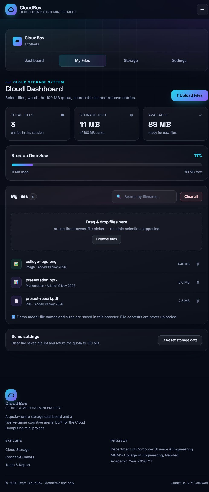
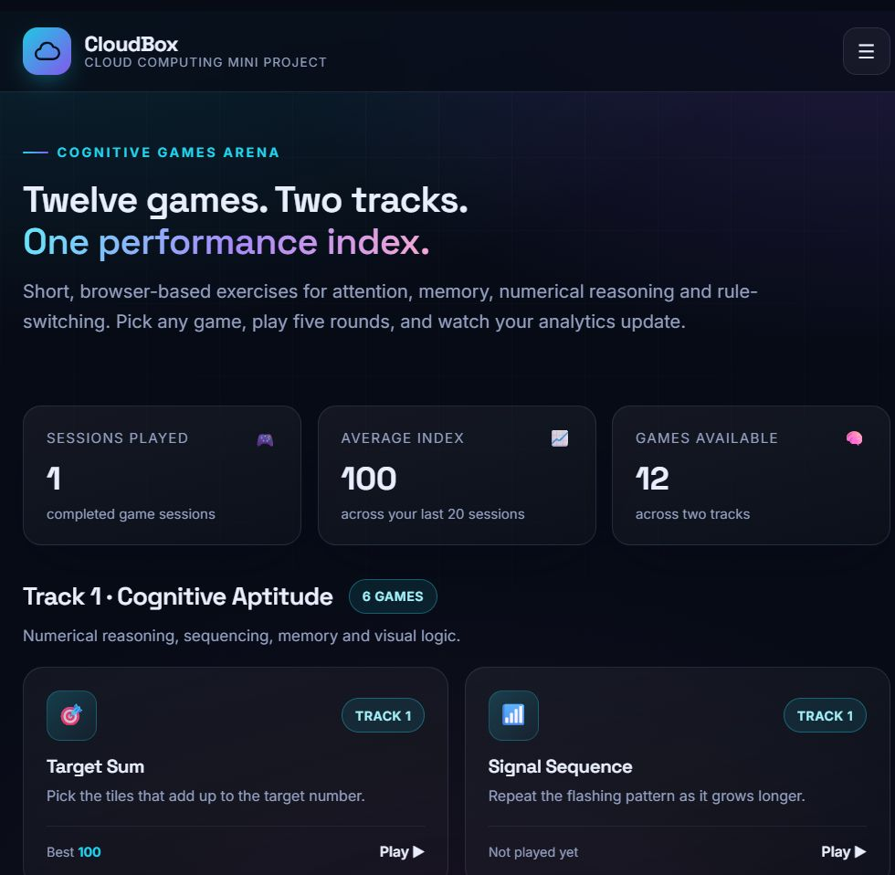
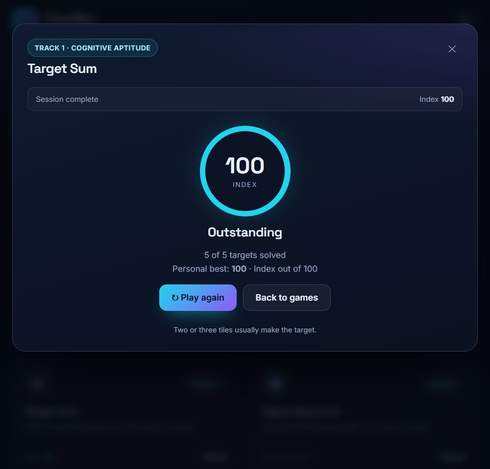

# ☁️ CloudBox — Cloud Computing Mini Project (2026-27)

A browser-based mini project that brings together two cloud-computing demonstrations:

1. **Cloud Storage Dashboard** — upload files, search, delete and manage a simulated **100 MB** storage quota.
2. **Cognitive Games Arena** — **12 short games** across two tracks, with instant scoring, performance indices and saved personal bests.

Built with **HTML5, CSS3 and vanilla JavaScript** — no dependencies, no build step, runs straight from the browser.

> **Live demo:** after GitHub Pages is enabled, the site is served at
> `https://s23kadamdhananjay-debug.github.io/Cloud-Computing-Pedagogical-Initiatives-Mini-Project--2026-2027/`

---

## 📌 Project information

| Field | Detail |
| --- | --- |
| **Project title** | CloudBox — Cloud Storage System & Cognitive Games |
| **Project type** | Cloud Computing mini project (frontend, client-side) |
| **Department** | Computer Science & Engineering (CSE) |
| **College** | Mahatma Gandhi Mission's College of Engineering, Nanded |
| **University** | Dr. Babasaheb Ambedkar Technological University (DBATU), Lonere |
| **Academic year** | 2026-27 |
| **Project guide** | Dr. S. Y. Gaikwad |

## 👨‍💻 Team

| Name | Roll No. |
| --- | :---: |
| **Dhananjay Kadam** | 133 |
| **Prajwal Govande** | 126 |
| **Bramanand Gaikwad** | 165 |
| **Virbhadra Sakarge** | 148 |
| **Krishna Rathod** | 147 |

---

## ✨ Features

### ☁️ Cloud Storage Dashboard (`storage.html`)

- Upload one or many files using the file picker or **drag & drop**.
- **100 MB quota guard** — a file is accepted only if the quota allows it, otherwise a warning toast is shown.
- Live dashboard cards: **total files**, **storage used** and **available space**.
- Animated **storage progress bar** with warning (75%+) and danger (90%+) states.
- **Search** the file list by filename.
- **Delete** individual entries, **clear all**, or reset the demo.
- File metadata persists across refreshes using `localStorage` (contents are never uploaded).
- Responsive layout with a collapsible mobile navigation.

### 🧠 Cognitive Games Arena (`games.html`)

Twelve playable games, each running **five quick rounds**:

| Track | Games |
| --- | --- |
| **Track 1 — Cognitive Aptitude** | Target Sum · Signal Sequence · Stack Sort · Function Machine · Pixel Logic · Matrix Complete |
| **Track 2 — Game-Based Assessment** | Digit Challenge · Grid Challenge · Motion Challenge · Switch Challenge · Geo-Sudo · Inductive Challenge |

- Instant feedback after every answer.
- **Performance index** (0–100) at the end of each session.
- Personal bests and analytics (**sessions played**, **average index**) saved in the browser.
- Keyboard support (Enter/Space to open a game, Esc to close).
- Fully responsive and dependency-free.

---

## 📸 Screenshots

| Cloud Storage Dashboard | Cognitive Games Arena |
| :---: | :---: |
|  |  |

<p align="center">
  
</p>

---

## 🛠️ Technology stack

| Technology | Role |
| --- | --- |
| **HTML5** | Page structure — dashboard, sidebar, game modal |
| **CSS3** | Dark glass UI, gradients, responsive grid and game styling |
| **JavaScript (ES6)** | File handling, quota checks, game logic, scoring, localStorage |
| **localStorage** | Client-side persistence for file metadata and game results |
| **GitHub Pages** | Static hosting for the project |

> The submitted report describes an earlier **React 19 + TypeScript + Vite + Tailwind CSS** implementation deployed on **Vercel**. This repository re-implements the same experience as a **dependency-free static site** so it can be opened, reviewed and hosted without a build step. The original report and presentation are included in [`docs/`](docs/).

---

## 📂 Project structure

```text
cloud-computing-mini-project/
├── index.html                     # Landing page / project dashboard
├── storage.html                   # Cloud storage dashboard (CloudBox)
├── games.html                     # Cognitive games arena (12 games)
├── team.html                      # Team, project details and documents
├── assets/
│   ├── css/
│   │   └── style.css              # Shared design system + responsive styles
│   └── js/
│       ├── common.js              # Navigation, active links, reveal animations
│       ├── storage.js             # Upload, quota, search, delete, persistence
│       └── games.js               # Game registry, modal, 12 game engines, stats
├── docs/
│   ├── Cloud_Computing_Mini_Project_Report.pdf
│   └── Cloud_Computing_Mini_Project_Presentation.pptx
├── .nojekyll                      # Keep GitHub Pages from processing the site
└── README.md
```

---

## 🚀 Run locally

No installation is required.

**Option 1 — open directly**

```text
Double-click index.html
```

**Option 2 — local server (recommended)**

```bash
# Python 3
python -m http.server 5500

# or Node.js
npx serve .
```

Then open `http://localhost:5500`.

---

## 🌐 Deploy on GitHub Pages

1. Push the project to a GitHub repository.
2. Open **Settings → Pages**.
3. Under **Build and deployment**, choose **Deploy from a branch**.
4. Select branch **main** and folder **/ (root)**, then save.
5. The site becomes available at `https://<username>.github.io/<repository>/`.

The project is fully static, so it also deploys unchanged to Vercel, Netlify or any static host.

---

## ⚙️ How it works

### Storage quota

```js
const MAX_BYTES = 100 * 1024 * 1024; // 100 MB

if (usedBytes + file.size > MAX_BYTES) {
  // reject this file and show a quota warning
}
```

Used storage is recalculated as the sum of every accepted file's size, then rendered in the dashboard cards, sidebar widget and progress bar.

### Search and delete

```js
const visible = files.filter(file =>
  file.name.toLowerCase().includes(query.toLowerCase())
);

files = files.filter(file => file.id !== id);
```

### Game scoring

Each game reports a **0–100 performance index** when its five rounds finish. Scores are stored under `cloudbox.gameStats.v1`, and personal bests are read back when the game cards render.

```js
localStorage.setItem("cloudbox.files.v1", JSON.stringify(files));
localStorage.setItem("cloudbox.gameStats.v1", JSON.stringify(stats));
```

---

## 📄 Report & presentation

Both documents are bundled in this repository:

- 📕 [Project Report (PDF)](docs/Cloud_Computing_Mini_Project_Report.pdf)
- 📊 [Mini Project Presentation (PPTX)](docs/Cloud_Computing_Mini_Project_Presentation.pptx)

---

## ⚠️ Limitations

- This is a **frontend demonstration**; no backend, cloud API or database is connected.
- File **contents** are never uploaded — only name, size and type are stored.
- Browser `localStorage` is limited to the current browser and device, and can be cleared by the user.
- The 100 MB quota is simulated and does not represent real cloud storage.

## 🔭 Future scope

- Add a backend (Node.js / Python) and real cloud object storage.
- Add user accounts, authentication and access control.
- Persist files and scores in a cloud database for cross-device access.
- Add file preview, download, sharing, encryption and audit logs.
- Add leaderboards, adaptive difficulty and multiplayer modes for the games.

---

## 📜 License

Created for **academic and educational purposes** as part of the Cloud Computing mini project, 2026-27.

**Team CloudBox** — Dhananjay Kadam (133) · Prajwal Govande (126) · Bramanand Gaikwad (165) · Virbhadra Sakarge (148)
